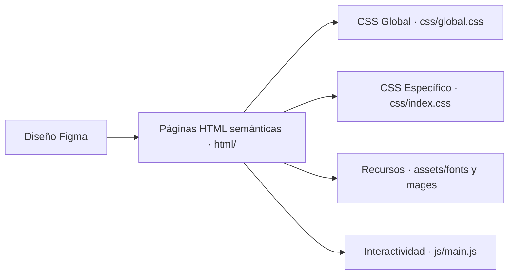

# myporfolio

Estructura de maquetación desarrollada con **HTML semántico + CSS puro (metodología BEM y Custom Properties)**[cite: 1, 3, 5].

## Arquitectura



GitHub renderiza este bloque `mermaid` automáticamente como un diagrama de flujo[cite: 1].

## Estructura

```text
porfolio/
├── assets/
│   ├── fonts/
│   │   ├── comic_neue/
│   │   └── source_code_pro/
│   └── images/
├── css/
│   ├── global.css        
│   └── index.css
├── html/
│   ├── contacto.html
│   ├── index.html
│   ├── proyecto.html
│   ├── sobremi.html
│   └── tecnologia.html
├── js/
│   └── main.js
├── LICENSE
└── README.md
```

# Variables (:root), reset y componentes globales (BEM)
# Estilos específicos de la página principal

## Cómo trabajar

1. **Previsualización:** Abre `html/index.html` con la extensión **Live Server** de VS Code para ver los cambios en tiempo real al guardar[cite: 1, 2].
2. **Design Tokens:** Define y reutiliza toda la paleta de colores y tipografías (`--font-primaria`, `--font-secundaria`) desde el selector `:root` en `css/global.css`[cite: 3].
3. **Metodología BEM:** Nombra las clases siguiendo la convención `.bloque__elemento--modificador` (por ejemplo, `.nav`, `.nav__menu`, `.nav__link`) para mantener baja la especificidad y facilitar el mantenimiento[cite: 4, 5].
4. **HTML semántico:** Estructura las vistas con etiquetas semánticas (`header`, `nav`, `main`, `section`, `footer`) y mantén los nombres de archivos y carpetas en minúsculas y sin espacios[cite: 1, 2].
5. **Interactividad:** Añade la lógica dinámica de la interfaz en `js/main.js`[cite: 2].